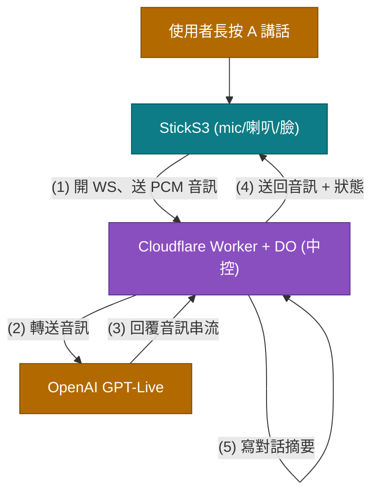

# M1-B 架構 — 語音對話（常駐）＋ Cloudflare 中控

> 目標：長按 A（或喚醒詞）→ StickS3 收音 → 經雲端中控接 GPT-Live 語音 → 回覆念出來，
> 表情同步切 Listening / Thinking / Speaking。對講機式（一人講完換另一邊），離線表情（M1-A）不受影響。
> 本檔是「怎麼接」的架構約定；畫面樣子見 `docs/StickS3 介面規格.html`。

## 1. 為什麼要中控（不讓 StickS3 直連 OpenAI）
- repo 公開，**API 金鑰不能放裝置**；金鑰只存在中控的 secret。
- GPT-Live 本來就把「講話」與「思考/工具」分開，需要一個後端協調 → 中控擔任。
- 「記在 GPT」API 做不到：對話紀錄由中控自己存（Durable Object storage）。
- 之後的工具呼叫（開燈、查天氣、新聞快報）都在中控執行。

## 2. 元件與職責
| 元件 | 角色 | 職責 |
| :-- | :-- | :-- |
| StickS3 | 嘴巴＋耳朵＋臉 | 收音（MEMS mic→ES8311）、播音（喇叭）、畫表情、長按 A/喚醒詞觸發 |
| Cloudflare Worker ＋ Durable Object | 中控（大腦調度） | 裝置 WebSocket 伺服器、持 OpenAI 連線、存對話、工具呼叫 |
| OpenAI GPT-Live-1 | 語音層 | 即時語音對話（$0.05/分 前端）；後端推理走 Responses 委派（先全 GPT） |
| Cloudflare Workers AI | 免費快報 | Cron 定時抓新聞→摘要→TTS（免費額度 10k neurons/日） |

## 3. 連線與資料流（對講機式一輪）

- 裝置↔中控：一條**常開 WebSocket**（DO Hibernatable，待機幾乎不花錢）。
- 只有「講話那一下」才開中控↔OpenAI 的語音連線，講完就關 → 省 $0.05/分。

## 4. 裝置 ↔ 中控 WebSocket 協定（草案）
連線：`wss://<中控>/ws?t=<HUB_TOKEN>`（B3.5）。token 不符時中控在升級成 WebSocket 之前回 401，不進 Durable Object。
裝置送：
- `{"t":"start"}`：長按 A 按下 → 中控開 OpenAI 連線，裝置進 Listening。
- 二進位音訊幀：PCM16，16kHz，單聲道，little-endian（上傳）。
- `{"t":"stop"}`：放開 A → 中控收尾，進 Thinking。
中控送：
- `{"t":"state","v":"listening|thinking|speaking|idle"}` → 裝置切表情。
- 二進位音訊幀：回覆語音 → 裝置播放、Speaking 嘴巴隨音量（`setSpeakLevel()`）。
- `{"t":"text","role":"user|assistant","s":"…"}` → 對話列顯示文字（直式 ≤5 行）。
- `{"t":"tool","name":"rf_send","args":{…}}` → 工具呼叫（M3/IR 接上後執行）。

**B3b-2 實作現況（純傳輸測試，尚未接 OpenAI）**：
- 裝置按下 A 送 `start`；放開後把錄音（已切頭尾按鍵聲、修突波，**未正規化**）切成 3200 bytes（100ms）的二進位幀依序上傳，每圈最多 2 幀，送完再送 `stop`。
- 中控收到 `start` 清空該連線的暫存；二進位幀依序暫存（每輪上限 256KB，超過回 `{"t":"error"}` 並丟棄）；收到 `stop` → `state=thinking` → 原樣照順序回傳 → `{"t":"audio_end","n":<bytes>}` → `state=idle`。
- 裝置收到 `audio_end` 後比對上傳／收回的 bytes 與 CRC32，再正規化＋淡入淡出播放。等 `audio_end` 逾時 8 秒放棄；中控未連線／上傳失敗／中途斷線 → 退回本機回放。
- 表情由裝置本機決定（Listening → Thinking → Speaking → Idle），中控的 `state` 目前只印序列埠；B3c 依真實節奏再定。

**B3b-3 格式協商與下載壓縮**：
- 裝置 `{"t":"start","up":"pcm16","down":"adpcm"}` → 中控回 `{"t":"format","up":..,"down":..}`（不認得的格式退回 `pcm16`；舊版裝置不帶欄位也是 `pcm16`）。裝置收到 `format` 才用 ADPCM 解，沒收到就當 PCM。
- `down=adpcm`：中控把 PCM 壓成 IMA ADPCM 幀（每幀 100ms＝1600 取樣：`int16 predictor`＋`uint8 step index`＋`uint8 保留`＋800 bytes，先低 4 bit），約 8KB/s；`audio_end` 加 `fmt` 與原始 `pcm` bytes。編碼在 `cloud/src/adpcm.js`、解碼在 `firmware/src/adpcm.cpp`。
- 上傳格式目前只有 `pcm16`；日後要壓縮上傳只需增加 `up` 的選項。
- 下載另有 `mulaw`（G.711 μ-law，16kHz、每取樣 8 bit、1/2 資料量、無狀態），**B3b-3 定案為預設**（實聽與原音無差；ADPCM 較糊，留作弱網備案）。下載不論格式都合併成每則 ≤8040 bytes 的訊息（v15 實測每則訊息約有 67ms 固定成本）；ADPCM 每則含多個固定 804 bytes 的幀，裝置依此拆回。

**B3b-4 邊收邊播**：
- `start` 多帶 `pace`：`fast`（預設，有多快送多快）或 `rt`（照音訊長度等待，壓力測試）；中控在 `format` 回覆裡一併確認。
- 新增 `down=adpcm8k`（**裝置預設**）：中控先正規化、低通、降到 8kHz，再 IMA ADPCM 編碼；幀格式與 `adpcm` 相同（1600 取樣／804 bytes，在 8kHz 下是 200ms），每則 3 幀（2412 bytes、0.6 秒）。裝置解壓後用半帶濾波器升回 16kHz。
- 每則大小：pcm16／mulaw 8000 bytes、adpcm 5 幀（4020 bytes）、adpcm8k 3 幀。
- 音量正規化改在中控（裝置邊收邊播拿不到整段峰值）；`audio_end` 多帶 `g`（增益）與 `ms`（音訊長度）。
- 新一輪 `start` 會取消上一輪還沒送完的音訊（不送 `audio_end`）。
- 這一輪的格式存在連線附件（`serializeAttachment`），DO 閒置休眠後仍找得回（見 `CLAUDE.md` 鐵則七第 9 點）。
- 裝置：中控未連線、上傳或等待中斷線 → 這輪結束、不再本機回放；回答播到一半斷線 → 已收到的播完。

## 5. 表情狀態對應（已在 M1-A 備好）
| 中控 state | 表情 | 觸發點 |
| :-- | :-- | :-- |
| listening | Listening（綠·漣漪） | A 按下、開始收音 |
| thinking | Thinking（藍·三點） | 放開 A、等 OpenAI |
| speaking | Speaking（白·嘴巴） | 收到回覆音訊，`setSpeakLevel()` 連動音量 |
| idle | Idle（青） | 一輪結束、收起對話列 |

## 6. 喚醒與結束
- **按鍵講話**：長按 A 開始、放開結束（最單純，先做這個）。
- **喚醒詞**：板上輕量偵測「嘿小S」才連線（省電/省錢）；較複雜，列切片後段。
- 常駐：語音是背景服務，可覆蓋在表情/資訊/選單上（空中滑鼠、HID 佔藍牙/USB 時先暫停）。

## 7. 對話紀錄儲存
- 存在 Durable Object storage（非裝置、非 ChatGPT）：對話摘要、已存訊號名稱表、使用者偏好。
- 每輪結束把摘要寫入；下次對話帶前文給模型。

## 8. 安全
- OpenAI / 其他金鑰 → `wrangler secret`，只在 Worker，絕不進 repo 或裝置。
- Wi-Fi 帳密、中控 URL → 裝置 NVS（不進 repo）。
- 裝置↔中控 token 驗證（B3.5 已實作）：`/ws?t=<HUB_TOKEN>`，中控以 SHA-256＋`crypto.subtle.timingSafeEqual` 固定時間比對，不符回 401、未設定回 503。token 存 `wrangler secret`（中控）與 `firmware/src/secrets.h`（裝置），設定指令見 `cloud/README.md`。
  - 選 query 而非 header（2026-11-18 Miles 決定）：裝置與 /test 頁同一套做法、好維護；代價是 token 會出現在 `wrangler tail` 的網址裡 → 貼 tail 輸出前要遮掉。
  - 裝置目前 `beginSSL` 不驗中控憑證（函式庫內部 `setInsecure()`）。只連家用 Wi-Fi 與自己的熱點，風險可接受；日後若要上不可信網路，改 `beginSslWithCA` 驗證 Cloudflare 根憑證。

## 9. 待確認 / 風險（實作前要查或驗）
1. **ES8311 同時收放**：CLAUDE.md 記錄現函式庫下喇叭/麥克風同一時間只能一個 → 對講機式剛好規避；若要「邊說邊打斷」需較底層同時收放＋回音消除，列後期。
2. **音訊格式/取樣率**（2026-11-18 查官方文件定案）：GPT-Live 端點 `wss://api.openai.com/v1/live/sessions`、模型 `gpt-live-1`；`session.audio.format` 支援 `audio/pcm` 24kHz（預設）／**16kHz**、`audio/pcmu`／`audio/pcma`（8kHz G.711）；同一格式同時套用輸入輸出、session 中不能改；送 `session.input_audio.append`、收 `session.output_audio.delta`。→ 中控↔OpenAI 用 PCM 16kHz，與裝置相同，**不需重取樣**。裝置↔中控是獨立一段，由中控轉碼（上傳 PCM16、下載 ADPCM 8kHz，見第 4 節）。
3. **延遲**：裝置→CF→OpenAI 兩段往返；對講機式可接受，實測確認。
4. **費用**：語音 $0.05/分（Pro 每月送的 API 額度可付）；Workers AI 快報用免費額度。粗估每天聊 20 分鐘 ≈ $1/天，用額度內。

## 10. 你（Miles）要先準備的
1. **Cloudflare 帳號**（免費方案即可開發）；裝 `wrangler`（CF 的 CLI）。
2. **OpenAI API 組織**：用與 ChatGPT Pro **同一個 email**，到 Billing 領取 Pro 的每月 API 額度並綁定該組織。
3. 把 **OpenAI API key** 設為 Worker secret（`wrangler secret put OPENAI_API_KEY`）。
4. 裝置端 Wi-Fi 帳密、中控 URL 之後寫進 NVS（會另給設定流程）。
> 這些要你的帳號權限，我無法代做；準備好後把「有沒有卡關」回報即可。

## 11. 切片拆分（一片一驗收）
- **B1 中控骨架**：Cloudflare Worker＋DO，裝置用假音訊/文字測 WebSocket 通、能存一筆對話。
- **B2 裝置連線**：StickS3 連 Wi-Fi、連中控 WS、長按 A 送 `start`/`stop`、收 `state` 切表情（先不接真音訊）。
- **B3 OpenAI 語音**：中控接 GPT-Live，跑通一輪真語音（裝置收音→回覆播放）。
- **B4 對話列與文字**：對話文字顯示（直式 ≤5 行/橫式側欄），Speaking 連動音量。
- **B5 新聞快報**：Workers AI Cron 定時摘要＋TTS 推播。
- **B6 喚醒詞**（選配）、工具呼叫接 M3/IR（之後）。

## 12. 開發分工
- **中控（Worker）**：純雲端、JS/TS，可在這端（Cowork/claude.ai）或 CLI 寫，`wrangler` 本機部署。
- **裝置韌體**：Mac 的 Claude Code CLI（PlatformIO 工具鏈），比照 M1-A 一片一燒錄。
