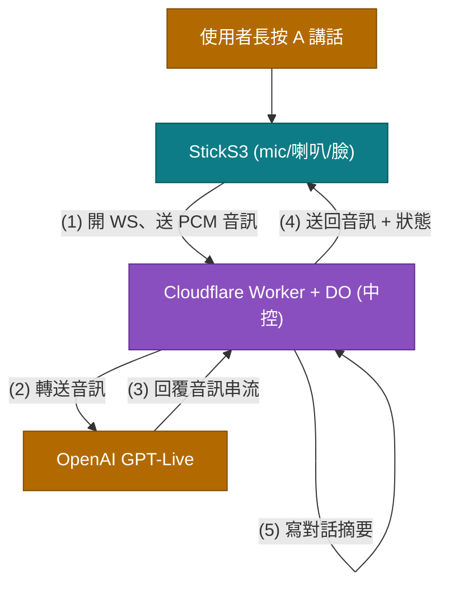

# M1-B 架構 — 語音對話（常駐）＋ Cloudflare 中控

> 目標：長按 A（或喚醒詞）→ StickS3 收音 → 經雲端中控接 GPT-Live 語音 → 回覆念出來，
> 表情同步切 Listening / Thinking / Speaking。對講機式（一人講完換另一邊），離線表情（M1-A）不受影響。
> 本檔是「怎麼接」的架構約定；畫面樣子見 `docs/StickS3 介面規格.html`。

## 1. 為什麼要中控（不讓 StickS3 直連 OpenAI）
- repo 公開，**API 金鑰不能放裝置**；金鑰只存在中控的 secret。
- GPT-Live 本來就把「講話」與「思考/工具」分開，需要一個後端協調 → 中控擔任。
- 「記在 GPT」API 做不到：對話紀錄由中控自己存（Durable Object storage）。
- 之後的工具呼叫（開燈、查天氣、新聞快報）都在中控執行。

## 2. 元件與職責
| 元件 | 角色 | 職責 |
| :-- | :-- | :-- |
| StickS3 | 嘴巴＋耳朵＋臉 | 收音（MEMS mic→ES8311）、播音（喇叭）、畫表情、長按 A/喚醒詞觸發 |
| Cloudflare Worker ＋ Durable Object | 中控（大腦調度） | 裝置 WebSocket 伺服器、持 OpenAI 連線、存對話、工具呼叫 |
| OpenAI GPT-Live-1 | 語音層 | 即時語音對話（$0.05/分 前端）；後端推理走 Responses 委派（先全 GPT） |
| Cloudflare Workers AI | 免費快報 | Cron 定時抓新聞→摘要→TTS（免費額度 10k neurons/日） |

## 3. 連線與資料流（對講機式一輪）

- 裝置↔中控：一條**常開 WebSocket**（DO Hibernatable，待機幾乎不花錢）。
- 只有「講話那一下」才開中控↔OpenAI 的語音連線，講完就關 → 省 $0.05/分。

## 4. 裝置 ↔ 中控 WebSocket 協定（草案）
裝置送：
- `{"t":"start"}`：長按 A 按下 → 中控開 OpenAI 連線，裝置進 Listening。
- 二進位音訊幀：PCM16，單聲道（取樣率待確認，見第 9 節）。
- `{"t":"stop"}`：放開 A → 中控收尾，進 Thinking。
中控送：
- `{"t":"state","v":"listening|thinking|speaking|idle"}` → 裝置切表情。
- 二進位音訊幀：回覆語音 → 裝置播放、Speaking 嘴巴隨音量（`setSpeakLevel()`）。
- `{"t":"text","role":"user|assistant","s":"…"}` → 對話列顯示文字（直式 ≤5 行）。
- `{"t":"tool","name":"rf_send","args":{…}}` → 工具呼叫（M3/IR 接上後執行）。

## 5. 表情狀態對應（已在 M1-A 備好）
| 中控 state | 表情 | 觸發點 |
| :-- | :-- | :-- |
| listening | Listening（綠·漣漪） | A 按下、開始收音 |
| thinking | Thinking（藍·三點） | 放開 A、等 OpenAI |
| speaking | Speaking（白·嘴巴） | 收到回覆音訊，`setSpeakLevel()` 連動音量 |
| idle | Idle（青） | 一輪結束、收起對話列 |

## 6. 喚醒與結束
- **按鍵講話**：長按 A 開始、放開結束（最單純，先做這個）。
- **喚醒詞**：板上輕量偵測「嘿小S」才連線（省電/省錢）；較複雜，列切片後段。
- 常駐：語音是背景服務，可覆蓋在表情/資訊/選單上（空中滑鼠、HID 佔藍牙/USB 時先暫停）。

## 7. 對話紀錄儲存
- 存在 Durable Object storage（非裝置、非 ChatGPT）：對話摘要、已存訊號名稱表、使用者偏好。
- 每輪結束把摘要寫入；下次對話帶前文給模型。

## 8. 安全
- OpenAI / 其他金鑰 → `wrangler secret`，只在 Worker，絕不進 repo 或裝置。
- Wi-Fi 帳密、中控 URL → 裝置 NVS（不進 repo）。
- 裝置↔中控可加一組 token 驗證，避免別人連你的中控。

## 9. 待確認 / 風險（實作前要查或驗）
1. **ES8311 同時收放**：CLAUDE.md 記錄現函式庫下喇叭/麥克風同一時間只能一個 → 對講機式剛好規避；若要「邊說邊打斷」需較底層同時收放＋回音消除，列後期。
2. **音訊格式/取樣率**：OpenAI 即時語音的輸入/輸出 PCM 取樣率、幀長；裝置 mic 取樣率與重取樣要對齊 → 實作時以官方文件為準。
3. **延遲**：裝置→CF→OpenAI 兩段往返；對講機式可接受，實測確認。
4. **費用**：語音 $0.05/分（Pro 每月送的 API 額度可付）；Workers AI 快報用免費額度。粗估每天聊 20 分鐘 ≈ $1/天，用額度內。

## 10. 你（Miles）要先準備的
1. **Cloudflare 帳號**（免費方案即可開發）；裝 `wrangler`（CF 的 CLI）。
2. **OpenAI API 組織**：用與 ChatGPT Pro **同一個 email**，到 Billing 領取 Pro 的每月 API 額度並綁定該組織。
3. 把 **OpenAI API key** 設為 Worker secret（`wrangler secret put OPENAI_API_KEY`）。
4. 裝置端 Wi-Fi 帳密、中控 URL 之後寫進 NVS（會另給設定流程）。
> 這些要你的帳號權限，我無法代做；準備好後把「有沒有卡關」回報即可。

## 11. 切片拆分（一片一驗收）
- **B1 中控骨架**：Cloudflare Worker＋DO，裝置用假音訊/文字測 WebSocket 通、能存一筆對話。
- **B2 裝置連線**：StickS3 連 Wi-Fi、連中控 WS、長按 A 送 `start`/`stop`、收 `state` 切表情（先不接真音訊）。
- **B3 OpenAI 語音**：中控接 GPT-Live，跑通一輪真語音（裝置收音→回覆播放）。
- **B4 對話列與文字**：對話文字顯示（直式 ≤5 行/橫式側欄），Speaking 連動音量。
- **B5 新聞快報**：Workers AI Cron 定時摘要＋TTS 推播。
- **B6 喚醒詞**（選配）、工具呼叫接 M3/IR（之後）。

## 12. 開發分工
- **中控（Worker）**：純雲端、JS/TS，可在這端（Cowork/claude.ai）或 CLI 寫，`wrangler` 本機部署。
- **裝置韌體**：Mac 的 Claude Code CLI（PlatformIO 工具鏈），比照 M1-A 一片一燒錄。
