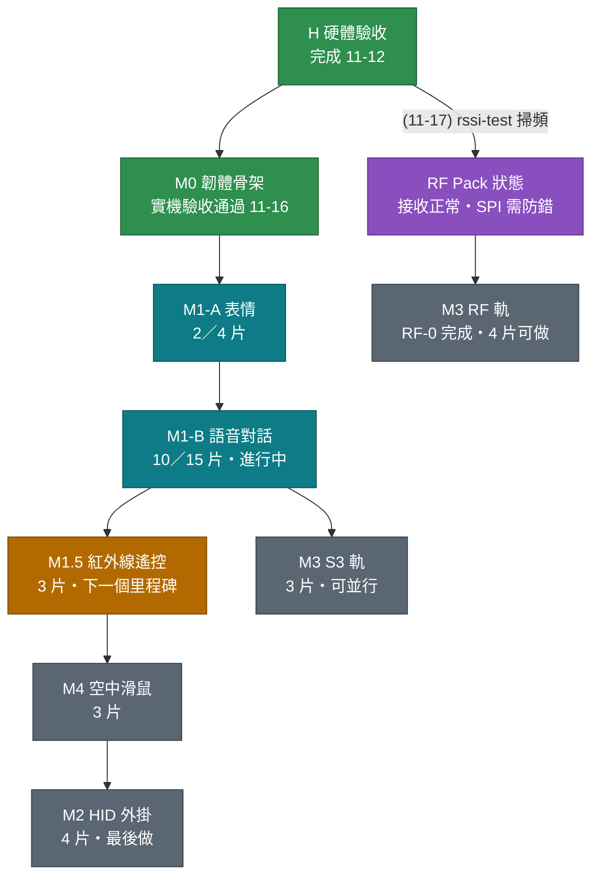
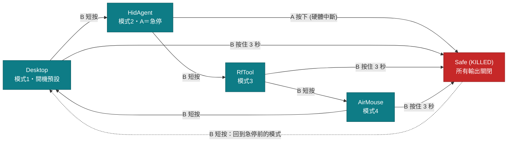

自學路線圖 · M5StickS3

# StickS3 執行計劃

用你手上的四樣硬體，從完全不會到能自己寫韌體：先讓機器動起來，再一路學會 C/C++、I2C、紅外線與 Sub-GHz 訊號、選單介面，最後把「用語音控制家電」整合成自己的作品。每一關都有動手目標和驗收標準。

**M5StickS3**ESP32-S3 主機・螢幕・紅外線收發・麥克風喇叭・IMU

**Scroll Unit**滾輪編碼器＋按鍵・I2C 0x40・當選單操作

**CardKB**迷你鍵盤・I2C 0x5F・輸入文字與指令

**RF Pack S3**CC1101 433MHz＋nRF24・SPI・Sub-GHz 訊號

0 / 9

## 怎麼用這份計畫

照編號一關一關往下走，每關做完勾「完成」，進度會自己記住。前期不用買齊，**第 0～4 關只要 StickS3 本體**就能開始；Scroll Unit、CardKB、RF Pack 到貨後再接上對應的關卡。

**把 Claude Code 當你的隨身助教。**你不用背語法——遇到看不懂的錯誤、要補完程式、要查某顆晶片的腳位，就把畫面和這份計畫貼給它，請它解釋、生成、逐行帶你讀。你負責理解「為什麼這樣設計」，打字交給它。

---

## 目前進度（更新於 2026-11-18）

正式韌體 `firmware/` 的里程碑依 `CLAUDE.md` 第 6 節排序。RF Pack 接收已驗證正常，SPI 需依規則防錯，**不卡任何里程碑**。每個里程碑的切片清單見下一節。



| 代號 | 里程碑 | 狀態 | 內容 |
| :-- | :-- | :-- | :-- |
| H | 硬體驗收 | ✅ 完成 11-12 | StickS3 自檢、nRF24、CC1101 SPI 通過；11-17 以 `rssi-test/` 確認 CC1101 接收正常（11-13 的故障判定撤回），SPI 讀取需防錯 |
| M0 | 韌體骨架 | ✅ 完成 11-16 | 狀態機、Grove 偵測、急停、狀態畫面，實機驗收通過。待補：插 CardKB／Scroll 的偵測實測（配件未到貨） |
| M1-A | 表情 | 🔵 2／4 片 | 九種表情已定案；剩 IMU 互動、直橫雙版面 |
| M1-B | 語音對話（常駐） | 🔵 11／13 片 | 中控已上線並加 token 驗證、OpenAI 文字已通、本機錄放音定案、Wi-Fi 滋滋聲解決、音訊來回中控通過；下載改 ADPCM 8kHz、邊收邊播、斷線畫面完成；邊錄邊傳＋網路背景化完成（不限錄音長度、斷線從頭重送）；下一片 **B3c 接 GPT-Live**（11-19 範圍收斂：剩 B3c→B4，B5／B6 移待辦） |
| M1.5 | 紅外線萬能遙控器 | 🟠 下一個 | S3 本體內建紅外線，腳位待實機驗證 |
| M4 | 空中體感滑鼠 | ⏳ 3 片 | BMI270 → 低通濾波 → BLE HID |
| M2 | 跨裝置 HID 外掛 | ⏳ 4 片・最後 | 先做 PC／macOS 版；急停為安全關鍵 |
| M3 | 無線電工具箱 | ⏳ S3 軌 3 片／RF 軌 5 片 | S3 軌（Wi-Fi／BLE 掃描）可並行；RF 軌接收已驗證，讀寫層依鐵則五第 7 點防錯 |

### 中控（雲端）現狀

- Cloudflare Worker ＋ Durable Object 已部署：**https://sticks3-hub.yenpang.workers.dev**（`/ws` WebSocket、`/test` 測試頁、`/health`）
- 程式在 `cloud/`，部署指令 `wrangler deploy`
- OpenAI 走 pay-as-you-go（ChatGPT Plus 沒有免費 API 額度），已儲值 US$10；key 以 `wrangler secret put OPENAI_API_KEY` 存在 Worker，不進 repo
- 裝置端的 Wi-Fi 帳密與中控位址放 `firmware/src/secrets.h`（git 忽略）

### RF Pack S3 狀態

1. 11-13 Bruce 實測 RSSI 不變，判定收訊故障、申請換貨
2. 11-14～15 與 PINGEQUA 往返、Bruce v1.17 重測
3. 11-17 自寫 `rssi-test/` 掃頻：315.00 MHz −16 dBm、333.00 MHz −18 dBm → **接收正常**，故障判定撤回（手邊遙控器不在 433.92 MHz）
4. 同日量出 SPI 單筆讀取約 0.5% 錯、錯誤成叢；高強度連續存取後會卡約 2 秒
5. **已請 PINGEQUA 用樣品對照、保留換貨選項 ← 目前在這**

**開發規則**：RF 軌照常開發與燒錄，但 CC1101 讀寫必須照 `CLAUDE.md` 鐵則五第 7 點——多數決（至少 3 筆）＋ `VERSION`=`0x14` 語意檢查、寫入一律驗證重寫、高強度存取之間留間隔。退換期可能在 **2026-11-20** 前，詳細數據見 `docs/cc1101-spi-reliability.md`。

### 養成關卡 ↔ 韌體里程碑

| 關卡 | 對應里程碑 | 狀態 |
| :-- | :-- | :-- |
| 0 開箱與環境 | 硬體驗收 | ✅ Bruce 已刷、PlatformIO 可編譯燒錄 |
| 1 Hello StickS3 | `selftest/`、M0 | ✅ 自檢與 M0 實機驗收都通過 |
| 2 IMU 感測器 | M1-A 切片 A3、M4 | ⏳ 下一批要做 |
| 3 Scroll Unit／I2C | M0 Grove 偵測 | 🟡 程式會掃 0x40，配件未到貨 |
| 4 紅外線 | M1.5（IR1～IR3） | 🟠 已排入・腳位待驗 |
| 5 CardKB＋狀態機 | M0 狀態機、M1-B 靜音輸入 | 🟡 狀態機已驗收，CardKB 未到貨 |
| 6 RF Pack／SPI | M3 RF 軌（RF-0～RF-4） | 🟢 接收已驗證；SPI 需防錯 |
| 7 統一遙控器 | M1.5＋M3＋NVS | ⏳ 排隊 |
| 8 連網與語音 | M1-B（B1～B4；B5／B6 移待辦） | 🔵 進行中，11／13 片完成 |

---

## 切片拆分：一片一驗收

規則不變：**先說要改哪些檔＋計畫 → 同意 → 寫 → Build／Upload（雲端用 `wrangler deploy`）→ 實機或 `/test` 驗收 → `git commit` → 下一片**。一次只動一片，驗收過才往下，變因才控制得住。

### M1-A 表情（4 片・2 完成）

| 片 | 內容 | 驗收方式 | 狀態 |
| :-- | :-- | :-- | :-- |
| A1 | 離線 Idle 臉：PSRAM sprite 畫圓角青色眼睛，上下呼吸（±9px／約 2 秒）＋隨機眨眼 | 開機即見表情，不連網 | ✅ 11-16 |
| A2 | 九種表情：Idle／Listening／Thinking／Speaking／Happy／Angry／Scared／Sleepy／Asleep，固定配色、眼型與過渡 | 實機逐一確認九種 | ✅ 11-16 |
| A3 | IMU 互動：搖晃→驚嚇、拍打→生氣、靜置久→想睡→睡著；取代目前按 A 循環切表情的測試用法 | 搖、拍、放著不動各觸發一次 | ⏳ 排在 B4 之後（11-19） |
| A4 | 直橫雙版面：文字條物理位置固定在藍鍵側，只有文字方向跟著轉；橫式支援兩個傾斜方向 | 轉動裝置，文字始終可讀 | ⏳ 排在 B4 之後（11-19） |

### M1-B 語音對話（13 片・11 完成；11-19 定案，不再加片）

| 片 | 內容 | 驗收方式 | 狀態 |
| :-- | :-- | :-- | :-- |
| B1 | 中控骨架：Cloudflare Worker＋Durable Object，WebSocket 協定、存對話、`/test` 測試頁 | `/test` 頁連線、收發、看紀錄 | ✅ 11-16 |
| B2a | 裝置連 Wi-Fi、連中控 WebSocket、每 20 秒 keepalive ping | 序列埠印連線成功與 IP | ✅ 11-16 |
| B2b | 長按 A 送 `start`／放開送 `stop`；中控回的 state 驅動表情切換 | 實機按鍵，表情跟著變 | ✅ 11-16 |
| B3a | 中控收到 `stop` 後真的呼叫 OpenAI 回文字，驗證 key／額度／模型可用 | `/test` 頁看到真回覆 | ✅ 11-16 |
| B3b-1 | 本機麥克風→喇叭回放，音質定案：分塊預排錄音（無空檔）、緩衝清零、ES8311 麥克風增益改「模擬 +21dB／數位 0dB」、喇叭取樣率 22050→16000 與乘數 1→4、DAC 靜音時序、正規化、淡入淡出。**噠聲主因是 A 鍵機械聲被錄進去**（滿幅固定在按下後約 40～50ms）→ 頭尾各切 60ms。錄音上限 6 秒，B3b-2 改串流後消失 | 按住 A 講話放開，聲音夠大、不破、無噠聲 | ✅ 11-18 |
| B3.5 | 連線 token 驗證（排在 B3b-2 之前）：裝置連 `/ws?t=<HUB_TOKEN>`、中控固定時間比對，不符回 401（設定見 `cloud/README.md`）。中控網址在公開 repo，不加這層任何人都能連上花 API 額度 | 改錯 token 會被拒、正確可連 | ✅ 11-18 |
| B3.6 | Wi-Fi 干擾滋滋聲：**原因是 Wi-Fi 省電模式（modem sleep）**——省電開必有、關掉就沒有；降發射功率無效。修法：錄放音期間關省電、結束開回（`net_hub::voiceActive()`）。量測工具留在韌體：序列埠 `s0/s1/sa`、`p<dBm>`、`g<PGA>`、`w0/w1`、`k`、`?`，每次錄音印「高頻底噪」等指標。背景嘶聲（偏高頻）不是 Wi-Fi，`g15`（PGA 降兩階）明顯改善 → B3b-2 處理音訊路徑時一起定 | Wi-Fi 連著錄音，聽不到滋滋聲 | ✅ 11-18 |
| B3b-2 | 裝置錄音以 WebSocket 二進位幀（3200 bytes＝100ms）上傳中控，中控原封不動回傳讓裝置播放（純傳輸測試，未接 OpenAI）。放開後整段上傳；CRC32 比對上傳／收回一致；中控未連線退回本機回放；表情本機決定。PGA 預設改 `0x15`（背景嘶聲明顯減少）。實測熱點 RTT 約 330ms、上傳約 36KB/s、下載約 25KB/s → 6 秒錄音來回約 12～13 秒，速度問題移到 B3b-3（規則見 `CLAUDE.md` 鐵則七） | 說一句 → 從雲端繞一圈 → 放出來 | ✅ 11-18 |
| B3b-3 | 下載壓縮＋格式欄位：`start` 帶 `up`／`down`，中控回 `{"t":"format"}` 確認（保險：上傳日後要壓縮只改欄位）。下載支援 PCM／IMA ADPCM／μ-law，一律合併成每則 ≤8040 bytes（每則訊息約 67ms 固定成本）。實測 5～6 秒錄音的等待回傳：PCM 6.3～6.6 秒、**μ-law 約 3.6 秒（SNR 36.6 dB，實聽與原音無差）**、ADPCM 約 2.0 秒（SNR 25 dB，較糊）→ **預設 μ-law**，ADPCM 為弱網備案（`f1`）。序列埠指令略過看不見的字元（開機第一個指令失效） | SNR 與實聽可接受；回傳時間明顯縮短 | ✅ 11-19 |
| B3b-4 | 邊收邊播＋斷線處理：中控 stop 後一則一則送（預設全速，`r1` 照真實速度做壓力測試），裝置緩衝 0.3 秒就開始播；喇叭由播放 task 的「緩衝釋放回呼」自己從 8 秒環形緩衝餵（主迴圈收一則訊息會被卡最久 2.5 秒）；斷音後補到 1 秒才繼續。11-19 熱點下載一度只剩約 8.8KB/s（RTT 630～760ms）→ **下載預設改 ADPCM 8kHz**（約 4KB/s，Miles 定案不另做聽感測試；裝置 8 階半帶濾波器升取樣）。音量正規化移到中控。斷線紀錄 `[link]`、ping 間隔 `i<秒>`；**斷線畫面**（Miles 選定）：斷線 >2 秒眼睛變灰＋表情定格＋右上 Wi-Fi 斜線、恢復回待機；回答播到一半斷線播完已收到的；上傳／等待中斷線不再本機回放。修正：中控 DO 閒置約 10 秒休眠會忘記這輪格式（按住 A 10 秒 → 爆音）→ 格式存連線附件。`ssl -80` 重置原因未抓到（帶到 B3b-5） | 放開後很快開始播、中途不斷音；印出緩衝餘量；斷線時畫面有提示、恢復後正常 | ✅ 11-19 |
| B3b-5 | 上傳邊錄邊傳＋網路背景化（11-19 定案）：WebSocket 收送全部移到網路 task（core 0、優先權 1、堆疊 10KB），主迴圈只交辦指令、讀收件佇列（PSRAM 1MB，文字與音訊同一條、保序）；網路 task 的 log 由主迴圈代印。錄音進 4MB PSRAM 環形緩衝（約 128 秒），**不設錄音上限**；網路 task 邊錄邊編 **μ-law（16KB/s）** 上傳，每則 8000 bytes；頭 60ms 跳過、尾 60ms 保留到放開才切。斷線重連後用同一個 turn id 從頭重送整段（Miles 選甲）；放開後 15 秒連不回來才放棄。收件佇列滿就暫停收（反壓，長回放不掉資料）。中控解 μ-law、每輪上限 64MB、存最近一段錄音（B3c 先導測試用）。11-19 `[link]` 紀錄：斷線是熱點 Wi-Fi 層 Beacon Timeout（原因碼 200→2，RSSI −67→−80），非中控，結案；**補強（11-19，同片）**：誤觸防護——按住不到 0.6 秒（`VOICE_MIN_PRESS_MS`）不上傳、不送 start/stop（Miles 選 A：一按就錄、滿 0.6 秒才送 start 與上傳）；錄音中連續 8 秒（`VOICE_AUTO_END_SILENCE_MS`）沒有人聲自動當作放開，人聲判斷用每 100ms 的一階差分 RMS（＝量測行「高頻底噪」指標），門檻 −55 dBFS（`VOICE_VAD_DBFS`；v20b 實機逐塊：安靜 −58.8～−60.5、講話 −39.8～−55；第一版 −48 把停頓後的輕聲當靜音而誤切，已改） | T1 連講 30 秒：錄音缺 0、主迴圈最長 <50ms、中控收到樣本＝送出、回放完整；T2 錄音中 `x` 斷線 → 整段重送；T3 講 90 秒以上不掉；T4 錄音中 B 長按 3 秒急停；上傳 ≥16KB/s 時放開後 ≤1 秒送完；補強：輕碰 A 不上傳、口袋壓住不說話 8 秒自動結束、正常講 30 秒且句間停 3 秒不被切 | ✅ 11-19（主體與補強皆通過；補強 v20c：誤觸不上傳、不說話 8.0 秒自動結束、25.6 秒講話含 5.1／3.4 秒停頓未被切） |
| B3c | 中控接 OpenAI GPT-Live（`gpt-live-1`，`wss://api.openai.com/v1/live/sessions`，`audio/pcm` 16kHz）。**官方事實**：沒有「使用者講完」指令、沒有「回答講完」事件、建議照錄音速度送。**定案**：按 A 才開 session、回答完 30 秒沒新對話就關，對話文字存 DO、新 session 帶最近 10 輪；過期（`session.closed` expired）自動重開。上傳 μ-law→PCM16→`session.input_audio.append`，session 就緒前暫存；放開後中控補靜音讓模型判斷講完。回覆 `session.output_audio.delta` 邊收邊轉 ADPCM 8kHz（串流版編碼器、固定增益）；按住 A 時模型先開口的音訊扣住到放開才送；輸出停頓超過門檻送 `audio_end`。**第一步先導測試**（中控用 B3b-5 存的錄音直接跑，不需裝置），結果直接套用：靜音長度＝實測＋0.5 秒（最多 3 秒）；快送正常就全速、否則照真實速度；上傳中斷時「不送」不會被搶話就不送、會就 mute、都不行就先收齊再餵；結束門檻＝句內最長停頓＋0.5 秒 **每日額度**（11-19 加）：中控用 DO storage 記當天（台北時間）的呼叫輪數與音訊秒數（上傳＋回覆），上限放 wrangler 變數 `DAILY_MAX_TURNS`（預設 200）、`DAILY_MAX_AUDIO_SEC`（預設 1800＝30 分鐘）；超過就不開 OpenAI session，回 `{"t":"error","code":"quota"}`＋`audio_end` n=0，裝置印「今日額度已用完」並回 Idle；echo 模式不計。 | 對它說一句話，它用語音回答；額度設很小時被拒絕 | ⏳ 下一片 |
| B4 | 對話列文字（只做直式；橫式併入 M1-A A4）：中控把 `input_transcript`／`output_transcript` 每 0.3 秒合併送 `{"t":"text"}`；裝置用 M5GFX 內建繁中字型 `efontTW_12`，底部 3～5 行、一行約 11 字；Speaking 嘴巴依播放音量（每塊 RMS）開合。Build 後確認韌體大小（app 分割 3.3MB） | 講完畫面出現逐字文字、嘴巴跟著聲音動 | ⏳ |
| ~~B5~~ | **移到待辦**（11-19 範圍收斂）：新聞快報（Workers AI Cron→摘要→TTS 推播） | — | 🗄 待辦 |
| ~~B6~~ | **移到待辦**（11-19 範圍收斂）：喚醒詞「嘿小S」；工具呼叫等 M1.5／M3 完成後再接 | — | 🗄 待辦 |

### M1.5 紅外線萬能遙控器（3 片・S3 本體可做）

| 片 | 內容 | 驗收方式 | 狀態 |
| :-- | :-- | :-- | :-- |
| IR1 | 腳位實機驗證（Bruce 標示 TX G46／RX G42，**未驗證、不可當定論**）＋接收電視遙控器碼，螢幕顯示協定與數值 | 按遙控器，螢幕印出 NEC 等協定與碼 | ⏳ |
| IR2 | 學習、命名、存 NVS（`Preferences`），重開機不消失 | 存三組碼，重開機還在 | ⏳ |
| IR3 | 選單重放：選已存的鍵發射。冷氣這類長碼（整組狀態一次送）另外處理 | 按下去，電視／冷氣真的動 | ⏳ |

### M4 空中體感滑鼠（3 片）

| 片 | 內容 | 驗收方式 | 狀態 |
| :-- | :-- | :-- | :-- |
| M4-1 | BMI270 姿態解算（Pitch／Yaw→游標）＋低通濾波，先在螢幕上畫游標，不碰藍牙 | 手腕轉動，螢幕游標跟著走且不抖 | ⏳ |
| M4-2 | NimBLE-Arduino 實作 BLE HID 滑鼠（比 Bluedroid 省記憶體），電腦認到裝置 | 電腦藍牙清單看到它，游標能動 | ⏳ |
| M4-3 | 按鍵整合：A＝左鍵、Scroll 滾動＝捲動、Scroll 按壓＝右鍵；進入本模式時語音暫停（鐵則二） | 能真的用它點擊與捲動 | ⏳ |

### M2 跨裝置 HID 外掛（4 片・最後做）

| 片 | 內容 | 驗收方式 | 狀態 |
| :-- | :-- | :-- | :-- |
| M2-1 | TinyUSB 複合鍵鼠：電腦認到 USB 鍵盤滑鼠、能打字移動游標。**開了原生 USB HID 後序列埠要改走第二路 CDC 或 UART** | 在記事本打出一行字 | ⏳ |
| M2-2 | 急停整合：A 鍵硬體中斷＋`killswitch::outputAllowed()` 閘門，送出任何封包前先查閘門 | 連續送字時拍 A，立刻停且斷線 | ⏳ |
| M2-3 | 電腦端代理：由電腦自己截圖送視覺模型、回傳座標與動作給 S3（避開參考專案那套 GPL 的 AirPlay 路線） | 說「點左上角的視窗」就點到 | ⏳ |
| M2-4 | 語音驅動：接 M1-B 中控的工具呼叫，語音直接指揮電腦操作 | 對它說一句話，電腦照做 | ⏳ |

### M3 無線電工具箱（S3 軌 3 片・RF 軌 5 片，RF-0 已完成）

| 片 | 內容 | 驗收方式 | 狀態 |
| :-- | :-- | :-- | :-- |
| S3-1 | Wi-Fi 掃描：列出周邊 AP、頻道、訊號強度（只被動掃描） | 掃到自家 Wi-Fi 並顯示強度 | ⏳ 可做 |
| S3-2 | BLE 掃描：列出周邊裝置與 RSSI | 掃到自己的手機／耳機 | ⏳ 可做 |
| S3-3 | 自有設備實驗模組（學習用途，**僅限自己的設備**，不做干擾） | 在自有裝置上驗證 | ⏳ 可做 |
| RF-0 | 接收驗收：`rssi-test/` 掃頻確認 CC1101 收得到（315.00 MHz −16 dBm、333.00 MHz −18 dBm）；同時量出 SPI 讀取約 0.5% 錯的特性並定出防錯規則（鐵則五第 7 點） | 按遙控器，掃頻看得到訊號 | ✅ 11-17 |
| RF-1 | RSSI 掃描：柱狀／瀑布圖顯示，靠近訊號源時喇叭發蓋革式嗶聲 | 按自家遙控器，圖上看得到 | ⏳ 可做 |
| RF-2 | 固定碼學習：PT2262／SC2260／EV1527 解碼，存 NVS 並命名 | 學到自家插座的碼 | ⏳ 可做 |
| RF-3 | 重放發射：315MHz 與 433.92MHz 雙頻（台灣遙控器常見這兩個）。**滾動碼不支援也不嘗試** | 重放後自家插座真的動 | ⏳ 可做 |
| RF-4 | nRF24 2.4GHz 掃描 | 掃到 2.4GHz 頻段活動 | ⏳ 可做 |

**安全與法律**：RF 與 HID 只用於自己的設備。433MHz 被動接收合法；主動發射僅限自有、低功率。滾動碼（新式車庫／車鑰）不支援也不嘗試，不實作任何干擾功能。警用無線電（P25 加密）永久排除。

---

## M0 圖解：燒進板子後的畫面與操作

M0 還沒有真功能：四個模式都是空殼，切換時只在序列埠印 `exit()`／`enter()`。它驗證的是骨架——**狀態機切得對、急停夠快、Grove 配件認得出來**。HTML 版有可以按的模擬器。

### 螢幕（直式 135×240，依 `ui_status.cpp`）

```
一般畫面（黑底）              急停畫面（紅底）
┌─────────────────┐          ┌─────────────────┐
│ M0 skeleton     │          │                 │
│                 │          │    KILLED       │
│ MODE            │          │                 │
│ Desktop   (青)  │          │ all output      │
│                 │          │   stopped       │
│ INPUT (Grove)   │          │ src : BtnA      │
│ CardKB    (白)  │          │ from: HidAgent  │
│                 │          │ gate: N us      │
│ KILL SWITCH     │          │                 │
│ OK (綠)／       │          │                 │
│ A=ARMED (橘)    │          │ B: resume       │
│                 │          │                 │
│ B     : next    │          └─────────────────┘
│ B 1-3s: report  │
│ B 3s  : KILL    │          gate: N us ＝急停第一段花的微秒數
│ A     : KILL／  │
│   (no action)   │
│ up 12s          │
└─────────────────┘
```

### 狀態機



（Safe 的返回箭頭畫到 Desktop 只是示意，實際會回到「進急停前」的那個模式。HidAgent 按住 B 3 秒同樣會急停。）

### 按鍵

| 操作 | 功能 |
| :-- | :-- |
| B 短按（<1 秒） | 下一個模式；在 Safe 中＝解除急停 |
| B 按住 1～3 秒後放開 | 序列埠重印狀態報告 |
| B 按住滿 3 秒 | 全域急停（不用等放開） |
| A | 只有 HidAgent 中是急停；其他模式 M0 只印 log |
| 電源鍵 | 韌體不用（單擊重置、雙擊關機） |

### 程式怎麼跑

- **開機（setup）**：`M5.begin()` → `input_hal` 開 Grove 5V、等 200ms、掃 I2C（0x5F＝CardKB、0x40＝Scroll）→ `killswitch` 建最高優先 task＋掛 A 鍵中斷 → `mode_manager` 進 Desktop → 畫畫面、印報告。
- **主迴圈（loop）每一圈**：(1) 急停已觸發 → 回收資源進 Safe；(2) 讀按鍵事件；(3) 每 500ms 重畫。全程不用長 `delay()`。
- **急停分兩段**：第一段在中斷裡直接關「輸出閘門」（微秒級，不等主迴圈）；第二段由主迴圈正式關資源、切 Safe、畫紅底（毫秒級）。

術語：**中斷（ISR）**＝硬體偵測到按鍵電位變化時，CPU 立刻暫停手上的事去跑一小段程式。**Task**＝FreeRTOS 裡可獨立排程的工作，優先權越高越先跑。**Sprite（畫布）**＝先在記憶體畫好整張畫面再一次推上螢幕，避免閃爍。

### M0 實機驗收清單

- [ ] 開機顯示 MODE＝Desktop、INPUT 顯示目前插的配件
- [ ] B 短按循環四個模式，序列埠依序印 `exit()` → `enter()`
- [ ] 插 CardKB／Scroll 後開機，INPUT 正確顯示
- [ ] HidAgent 按 A → 紅底 KILLED；B 短按恢復。AirMouse 按 A 不急停，B 按住 3 秒才急停
- [ ] A、B 交錯連打 20 次不當機

這一輪不用裝 RF Pack。燒錄連不上時：長按電源鍵約 2 秒到綠燈閃 → 放開 → Upload，燒完短按電源鍵啟動。

---


0 開箱與環境準備 先確認硬體是活的，再把 Mac 的開發環境裝好收合展開

硬體

StickS3 ＋ USB-C 資料線

程式觀念

韌體/firmware燒錄/flash序列埠

時間

約 1 晚

#### 動手做

1. 用瀏覽器到 flash.pingequa.com 或 bruce.computer/flasher，把 Bruce 韌體刷進去——這一步**不用寫程式**，先證明板子、線、Mac 三者都正常。
2. 在 Mac 裝開發環境：安裝 **VS Code ＋ PlatformIO**（嵌入式開發用的編譯燒錄外掛）。請 Claude Code 幫你一步步裝好、建立第一個 StickS3 專案。
3. 認識硬體地圖：ESP32-S3（大腦）、1.14 吋螢幕、正面按鈕、IMU、紅外線、Grove 孔、背面 Hat2 排針、麥克風喇叭。

#### 里程碑

Bruce 開機畫面出現；PlatformIO 能編譯並上傳一個空白專案到 StickS3 不報錯。

[ ] 完成這一關

1 第一支程式：Hello StickS3 螢幕顯示、讀按鈕、序列埠除錯收合展開

硬體

StickS3

程式觀念

setup/loop變數・函式數位輸入序列埠除錯

時間

約 1～2 晚

#### 動手做

1. 在螢幕印出文字，理解 setup()（開機跑一次）和 loop()（反覆跑）的差別。
2. 讀正面藍色按鈕，按一下讓螢幕計數 ＋1，並用序列埠（Serial Monitor）同步印出數字——學會「用印訊息來除錯」。
3. 把顏色、字體大小、位置玩一遍，熟悉座標。

```
// 用 M5Unified 函式庫，它會自動辨識 StickS3
#include <M5Unified.h>
int count = 0;
void setup() {
  M5.begin();                 // 初始化螢幕、按鈕、電源
  M5.Display.setTextSize(3);
  M5.Display.print("Hello StickS3");
}
void loop() {
  M5.update();                // 每圈更新按鈕狀態
  if (M5.BtnA.wasPressed()) { // 正面按鈕被按下
    count++;
    M5.Display.clear();
    M5.Display.setCursor(0, 0);
    M5.Display.printf("count: %d", count);
    Serial.printf("count=%d\n", count); // 送到序列埠除錯
  }
}
```

按鈕名稱、腳位依 StickS3 版本可能微調，交給 Claude Code 依規格確認。

#### 里程碑

按一下按鈕，螢幕和序列埠都看到數字 ＋1。你看得懂這段每一行在做什麼。

[ ] 完成這一關

2 感測器：讓機器「感覺」 用 IMU 偵測搖晃與傾斜收合展開

硬體

StickS3（內建 IMU）

程式觀念

浮點數條件判斷感測器讀值門檻/threshold

時間

約 1 晚

#### 動手做

1. 讀六軸 IMU 的加速度，印在螢幕上，邊搖邊看數字怎麼變。
2. 設一個「門檻值」：當加速度超過某值就判定為「搖晃」，螢幕顯示一個表情或換底色。
3. 做「螢幕朝下＝睡眠」：用 Z 軸判斷翻面，把背光關掉。

#### 里程碑

搖一搖螢幕有反應、翻過來會「睡著」。你學會把感測器的連續數值變成「事件」。

[ ] 完成這一關

3 接上 Scroll Unit：學會 I2C 外接裝置怎麼跟主機對話收合展開

硬體

StickS3 ＋ **Scroll Unit**（Grove）

程式觀念

I2C 匯流排裝置位址函式庫讀規格書

時間

約 2 晚

#### 動手做

1. 先跑一支「I2C 掃描器」，掃出接在 Grove 上的裝置位址——應該看到 Scroll Unit 的 0x40。這一步讓你真正理解「位址」是什麼。
2. 裝 M5 的 Scroll Unit 函式庫，讀滾輪的轉動值和按鍵狀態，印在螢幕上。
3. 把「轉滾輪＝數字增減、按下＝歸零」做出來。

```
// I2C 掃描器：找出 Grove 上接了哪些裝置
#include <Wire.h>
void setup() {
  Serial.begin(115200);
  Wire.begin();               // Grove 的 I2C 腳位讓 Claude Code 依 StickS3 補上
  for (uint8_t a = 1; a < 127; a++) {
    Wire.beginTransmission(a);
    if (Wire.endTransmission() == 0)
      Serial.printf("found 0x%02X\n", a); // 掃到就印位址
  }
}
void loop() {}
```

#### 里程碑

掃描器印出 0x40；轉滾輪時螢幕數字跟著動。你懂了「一條線上掛多個裝置、靠位址分辨」這個核心觀念。

[ ] 完成這一關

4 第一次訊號複製：紅外線 學會你家電視遙控器的碼，再發射出去收合展開

硬體

StickS3（內建紅外線收發）

程式觀念

紅外線協定時序/timing編碼解碼位元運算

時間

約 2～3 晚

#### 動手做

1. 用紅外線接收，把電視遙控器的碼解出來，螢幕顯示協定（如 NEC）和數值。
2. 把學到的碼存成變數，按按鈕時用紅外線發射出去，實際控制電視。
3. 理解「固定碼可複製、滾動碼不行」，並知道只玩自己的設備。

```
// 用 IRremoteESP8266：接收並印出遙控器的碼
#include <IRrecv.h>
#include <IRutils.h>
IRrecv irrecv(IR_RX_PIN);      // 腳位讓 Claude Code 依 StickS3 補上
decode_results r;
void setup() { Serial.begin(115200); irrecv.enableIRIn(); }
void loop() {
  if (irrecv.decode(&r)) {
    Serial.println(resultToHumanReadableBasic(&r)); // 協定＋碼
    irrecv.resume();           // 準備收下一個
  }
}
```

#### 里程碑

按你 StickS3 上的鍵，電視真的開關了。這是你的第一個「複製訊號控制家電」成果。

[ ] 完成這一關

5 接上 CardKB：文字輸入與選單 把操作介面做得好用收合展開

硬體

StickS3 ＋ **Scroll Unit** ＋ **CardKB**

程式觀念

狀態機陣列/清單字串處理事件迴圈

時間

約 2～3 晚

#### 動手做

1. 用 Scroll Unit 做一個可上下捲動、按下選取的選單（這是你之後所有功能的共用骨架）。
2. 接上 CardKB（I2C 0x5F），讀鍵盤輸入，讓你能幫每個項目命名、輸入數值。
3. 學「狀態機」：用一個變數記住現在在哪一頁（主選單／輸入中／執行中），畫面跟著切換。

#### 里程碑

一個滾輪捲、鍵盤打字的選單系統成形。你學會用狀態機組織一個互動程式。

[ ] 完成這一關

6 接上 RF Pack：Sub-GHz 與 SPI 433MHz 無線訊號的擷取與分析收合展開

硬體

StickS3 ＋ **RF Pack S3**（背面螺絲鎖）

程式觀念

SPI 匯流排調變 OOK/ASK固定碼 vs 滾動碼頻率

時間

約 3 晚

> **2026-11-17 硬體狀態**：CC1101 **接收正常**（`rssi-test/` 掃到 315／333 MHz，11-13 的「收訊故障」判定撤回）。但 SPI 單筆讀取約 0.5% 會錯，這一關的程式照常寫、照常燒錄，讀寫一律照 `CLAUDE.md` 鐵則五第 7 點防錯（多數決＋寫入驗證）。換貨未定。

#### 動手做

1. 先用 Bruce 的 Sub-GHz 功能擷取一個 433MHz 裝置（你自己的無線插座／門鈴），看它的頻率與波形。
2. 進階：在自己的程式裡用 SPI 驅動 CC1101，接收 OOK 訊號，理解「SPI 和 I2C 的差別」。
3. 把固定碼存下來、重放，驗證能不能控制那個裝置。

#### 里程碑

擷取到自家無線插座的 433MHz 碼並成功重放。你現在同時掌握 I2C（週邊）和 SPI（高速模組）兩種匯流排。

[ ] 完成這一關

7 整合作品：自製統一遙控器 把前面學的全部串起來收合展開

硬體

四樣全上

程式觀念

資料持久化 NVS模組化專案架構

時間

約 1 週

#### 動手做

1. 做一個選單：滾輪選「IR 家電」或「RF 裝置」→ 進去選已存的鍵 → 發射。CardKB 用來新增、命名。
2. 學「資料持久化」：用 Preferences/NVS 把學到的碼存進快閃記憶體，關機也不會不見。
3. 把程式拆成幾個檔案（IR 一塊、RF 一塊、選單一塊），體會「模組化」為什麼重要。

#### 里程碑

一台你自己寫的統一遙控器：能學、能存、能發，重開機資料還在。這是你的第一個完整作品。

[ ] 完成這一關

8 連網與語音：走向 AI 助手 Wi-Fi、API、小智，與串接電腦收合展開

硬體

StickS3（麥克風喇叭）

程式觀念

Wi-Fi/網路JSONAPI 呼叫ESP-IDFMCP

時間

約 1～2 週

#### 動手做

1. 連 Wi-Fi，打一個 HTTP API、解析 JSON 回應，把結果顯示在螢幕——學會機器怎麼上網拿資料。
2. 刷官方「小智」韌體，體驗語音助手；再研究怎麼把麥克風音訊串到電腦／雲端 AI。
3. 進階終點：用 ESP-IDF 在小智裡加一個 MCP 工具，讓你「說一句話」就觸發第 7 關的紅外線／RF 發射——語音控制家電成形。

#### 里程碑

對著機器說「幫我開電視」，它就發射紅外線開電視。你走完了從點燈到 AI 語音整合的一整條路。

[ ] 完成這一關

## 走完之後，你會的

- C/C++ 嵌入式程式：變數、函式、條件、陣列、狀態機、模組化
- 硬體溝通三大介面：GPIO、I2C、SPI，以及怎麼讀規格書找位址與腳位
- 訊號知識：紅外線與 Sub-GHz 的編碼、調變、固定碼與滾動碼
- 連網與整合：Wi-Fi、API、JSON，以及 ESP-IDF 與 MCP 的 AI 整合
- 最重要的：把一個想法，一路做成一台能用的裝置

這份計畫以 M5StickS3、Scroll Unit、CardKB、RF Pack S3 四樣硬體設計。程式片段為示意骨架，確切腳位與函式庫版本請搭配 Claude Code 依你的實機補完。只分析與控制自有設備。