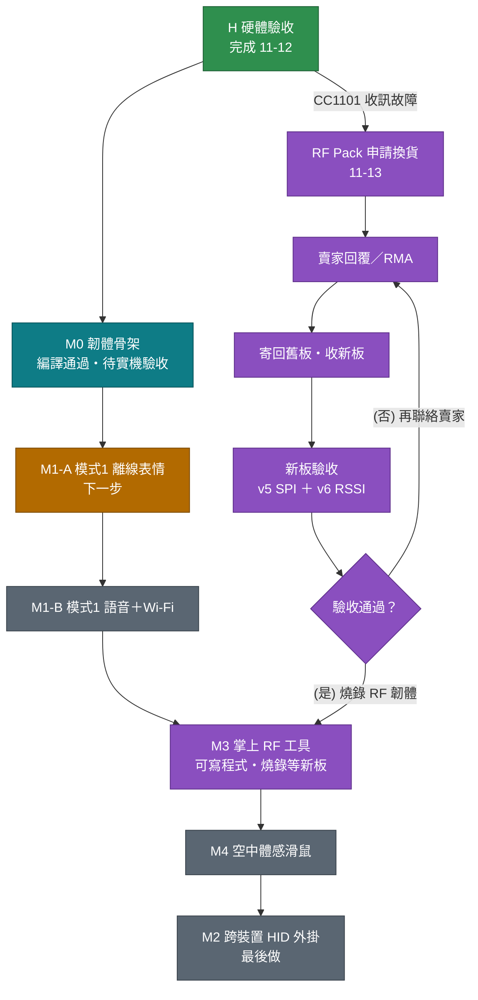
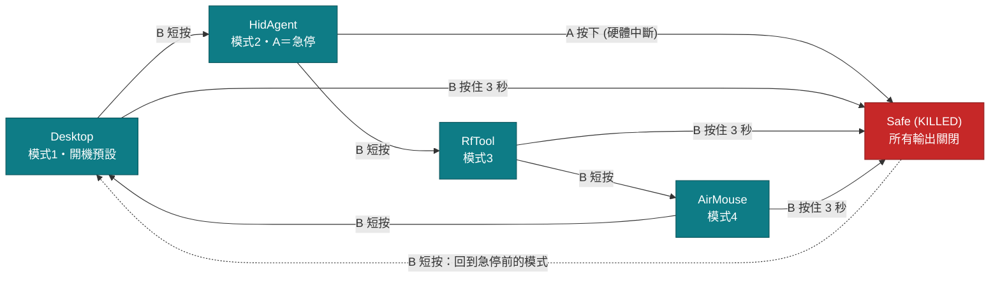

自學路線圖 · M5StickS3

# StickS3 執行計劃

用你手上的四樣硬體，從完全不會到能自己寫韌體：先讓機器動起來，再一路學會 C/C++、I2C、紅外線與 Sub-GHz 訊號、選單介面，最後把「用語音控制家電」整合成自己的作品。每一關都有動手目標和驗收標準。

**M5StickS3**ESP32-S3 主機・螢幕・紅外線收發・麥克風喇叭・IMU

**Scroll Unit**滾輪編碼器＋按鍵・I2C 0x40・當選單操作

**CardKB**迷你鍵盤・I2C 0x5F・輸入文字與指令

**RF Pack S3**CC1101 433MHz＋nRF24・SPI・Sub-GHz 訊號

0 / 9

## 怎麼用這份計畫

照編號一關一關往下走，每關做完勾「完成」，進度會自己記住。前期不用買齊，**第 0～4 關只要 StickS3 本體**就能開始；Scroll Unit、CardKB、RF Pack 到貨後再接上對應的關卡。

**把 Claude Code 當你的隨身助教。**你不用背語法——遇到看不懂的錯誤、要補完程式、要查某顆晶片的腳位，就把畫面和這份計畫貼給它，請它解釋、生成、逐行帶你讀。你負責理解「為什麼這樣設計」，打字交給它。

---

## 目前進度（更新於 2026-11-13）

正式韌體 `firmware/` 的里程碑依 `CLAUDE.md` 第 6 節排序。RF Pack 換貨是一條支線，**只卡 M3 的燒錄實測，不卡開發**。



| 代號 | 里程碑 | 狀態 | 內容 |
| :-- | :-- | :-- | :-- |
| H | 硬體驗收 | ✅ 完成 11-12 | StickS3 自檢、nRF24、CC1101 SPI 通過；11-13 確認 CC1101 收訊故障（RSSI 恆定約 -50 dBm、拔天線不變）→ 換貨 |
| M0 | 韌體骨架 | 🔵 待實機驗收 | 狀態機、Grove 偵測、急停、狀態畫面；編譯通過（RAM 7.3%、Flash 16.6%） |
| M1-A | 模式 1 離線表情 | 🟠 下一步 | Grok 風幾何臉 Idle 呼吸＋眨眼，不連網 |
| M1-B | 模式 1 語音＋Wi-Fi | ⏳ | 麥克風 → STT／LLM／TTS → 喇叭；CardKB 靜音輸入 |
| M3 | 掌上 RF 工具 | 🟣 可開發 | RSSI 掃描、固定碼學習／存 NVS／重放；**新板通過驗收後才燒錄實測** |
| M4 | 空中體感滑鼠 | ⏳ | BMI270 → 低通濾波 → BLE HID |
| M2 | 跨裝置 HID 外掛 | ⏳ 最後 | 先做 PC／macOS 版；急停為安全關鍵 |

### RF Pack S3 換貨支線

1. 11-13 確認故障、決定換貨（不退款）
2. **寄信給 PINGEQUA ← 目前在這**（退換期限約 2026-11-26）
3. 賣家回覆／RMA 編號 → 寄回舊板 → 收到新板
4. 重跑驗收：`acceptance-test` v5（SPI）＋ v6（RSSI：有天線／拔天線／按遙控器；正常背景約 -95～-105 dBm 且拔天線會變）
5. **合流點**：v5＋v6 都通過，才把含 RF 功能的韌體燒進「StickS3＋新 RF Pack」做 M3 實測

等待期間開發照常，M3 的程式也照寫、照編譯。M0／M1／M4 只用到 StickS3 本體，隨時可以燒錄。

### 養成關卡 ↔ 韌體里程碑

| 關卡 | 對應里程碑 | 狀態 |
| :-- | :-- | :-- |
| 0 開箱與環境 | 硬體驗收 | ✅ Bruce 已刷、PlatformIO 可編譯燒錄 |
| 1 Hello StickS3 | `selftest/`、M0 | ✅ 自檢通過；M0 待燒錄 |
| 2 IMU 感測器 | M4 | ⏳ |
| 3 Scroll Unit／I2C | M0 Grove 偵測 | 🟡 待插配件實測 |
| 4 紅外線 | 四模式以外（選修） | ⏳ 未排入 |
| 5 CardKB＋狀態機 | M0 狀態機、M1 靜音輸入 | 🟡 狀態機已寫好 |
| 6 RF Pack／SPI | M3 | 🟣 SPI 已驗證；收訊等新板 |
| 7 統一遙控器 | M3＋NVS | ⏳ |
| 8 連網與語音 | M1-B | ⏳ |

---

## M0 圖解：燒進板子後的畫面與操作

M0 還沒有真功能：四個模式都是空殼，切換時只在序列埠印 `exit()`／`enter()`。它驗證的是骨架——**狀態機切得對、急停夠快、Grove 配件認得出來**。HTML 版有可以按的模擬器。

### 螢幕（直式 135×240，依 `ui_status.cpp`）

```
一般畫面（黑底）              急停畫面（紅底）
┌─────────────────┐          ┌─────────────────┐
│ M0 skeleton     │          │                 │
│                 │          │    KILLED       │
│ MODE            │          │                 │
│ Desktop   (青)  │          │ all output      │
│                 │          │   stopped       │
│ INPUT (Grove)   │          │ src : BtnA      │
│ CardKB    (白)  │          │ from: HidAgent  │
│                 │          │ gate: N us      │
│ KILL SWITCH     │          │                 │
│ OK (綠)／       │          │                 │
│ A=ARMED (橘)    │          │ B: resume       │
│                 │          │                 │
│ B     : next    │          └─────────────────┘
│ B 1-3s: report  │
│ B 3s  : KILL    │          gate: N us ＝急停第一段花的微秒數
│ A     : KILL／  │
│   (no action)   │
│ up 12s          │
└─────────────────┘
```

### 狀態機



（Safe 的返回箭頭畫到 Desktop 只是示意，實際會回到「進急停前」的那個模式。HidAgent 按住 B 3 秒同樣會急停。）

### 按鍵

| 操作 | 功能 |
| :-- | :-- |
| B 短按（<1 秒） | 下一個模式；在 Safe 中＝解除急停 |
| B 按住 1～3 秒後放開 | 序列埠重印狀態報告 |
| B 按住滿 3 秒 | 全域急停（不用等放開） |
| A | 只有 HidAgent 中是急停；其他模式 M0 只印 log |
| 電源鍵 | 韌體不用（單擊重置、雙擊關機） |

### 程式怎麼跑

- **開機（setup）**：`M5.begin()` → `input_hal` 開 Grove 5V、等 200ms、掃 I2C（0x5F＝CardKB、0x40＝Scroll）→ `killswitch` 建最高優先 task＋掛 A 鍵中斷 → `mode_manager` 進 Desktop → 畫畫面、印報告。
- **主迴圈（loop）每一圈**：(1) 急停已觸發 → 回收資源進 Safe；(2) 讀按鍵事件；(3) 每 500ms 重畫。全程不用長 `delay()`。
- **急停分兩段**：第一段在中斷裡直接關「輸出閘門」（微秒級，不等主迴圈）；第二段由主迴圈正式關資源、切 Safe、畫紅底（毫秒級）。

術語：**中斷（ISR）**＝硬體偵測到按鍵電位變化時，CPU 立刻暫停手上的事去跑一小段程式。**Task**＝FreeRTOS 裡可獨立排程的工作，優先權越高越先跑。**Sprite（畫布）**＝先在記憶體畫好整張畫面再一次推上螢幕，避免閃爍。

### M0 實機驗收清單

- [ ] 開機顯示 MODE＝Desktop、INPUT 顯示目前插的配件
- [ ] B 短按循環四個模式，序列埠依序印 `exit()` → `enter()`
- [ ] 插 CardKB／Scroll 後開機，INPUT 正確顯示
- [ ] HidAgent 按 A → 紅底 KILLED；B 短按恢復。AirMouse 按 A 不急停，B 按住 3 秒才急停
- [ ] A、B 交錯連打 20 次不當機

這一輪不用裝 RF Pack。燒錄連不上時：長按電源鍵約 2 秒到綠燈閃 → 放開 → Upload，燒完短按電源鍵啟動。

---


0 開箱與環境準備 先確認硬體是活的，再把 Mac 的開發環境裝好收合展開

硬體

StickS3 ＋ USB-C 資料線

程式觀念

韌體/firmware燒錄/flash序列埠

時間

約 1 晚

#### 動手做

1. 用瀏覽器到 flash.pingequa.com 或 bruce.computer/flasher，把 Bruce 韌體刷進去——這一步**不用寫程式**，先證明板子、線、Mac 三者都正常。
2. 在 Mac 裝開發環境：安裝 **VS Code ＋ PlatformIO**（嵌入式開發用的編譯燒錄外掛）。請 Claude Code 幫你一步步裝好、建立第一個 StickS3 專案。
3. 認識硬體地圖：ESP32-S3（大腦）、1.14 吋螢幕、正面按鈕、IMU、紅外線、Grove 孔、背面 Hat2 排針、麥克風喇叭。

#### 里程碑

Bruce 開機畫面出現；PlatformIO 能編譯並上傳一個空白專案到 StickS3 不報錯。

[ ] 完成這一關

1 第一支程式：Hello StickS3 螢幕顯示、讀按鈕、序列埠除錯收合展開

硬體

StickS3

程式觀念

setup/loop變數・函式數位輸入序列埠除錯

時間

約 1～2 晚

#### 動手做

1. 在螢幕印出文字，理解 setup()（開機跑一次）和 loop()（反覆跑）的差別。
2. 讀正面藍色按鈕，按一下讓螢幕計數 ＋1，並用序列埠（Serial Monitor）同步印出數字——學會「用印訊息來除錯」。
3. 把顏色、字體大小、位置玩一遍，熟悉座標。

```
// 用 M5Unified 函式庫，它會自動辨識 StickS3
#include <M5Unified.h>
int count = 0;
void setup() {
  M5.begin();                 // 初始化螢幕、按鈕、電源
  M5.Display.setTextSize(3);
  M5.Display.print("Hello StickS3");
}
void loop() {
  M5.update();                // 每圈更新按鈕狀態
  if (M5.BtnA.wasPressed()) { // 正面按鈕被按下
    count++;
    M5.Display.clear();
    M5.Display.setCursor(0, 0);
    M5.Display.printf("count: %d", count);
    Serial.printf("count=%d\n", count); // 送到序列埠除錯
  }
}
```

按鈕名稱、腳位依 StickS3 版本可能微調，交給 Claude Code 依規格確認。

#### 里程碑

按一下按鈕，螢幕和序列埠都看到數字 ＋1。你看得懂這段每一行在做什麼。

[ ] 完成這一關

2 感測器：讓機器「感覺」 用 IMU 偵測搖晃與傾斜收合展開

硬體

StickS3（內建 IMU）

程式觀念

浮點數條件判斷感測器讀值門檻/threshold

時間

約 1 晚

#### 動手做

1. 讀六軸 IMU 的加速度，印在螢幕上，邊搖邊看數字怎麼變。
2. 設一個「門檻值」：當加速度超過某值就判定為「搖晃」，螢幕顯示一個表情或換底色。
3. 做「螢幕朝下＝睡眠」：用 Z 軸判斷翻面，把背光關掉。

#### 里程碑

搖一搖螢幕有反應、翻過來會「睡著」。你學會把感測器的連續數值變成「事件」。

[ ] 完成這一關

3 接上 Scroll Unit：學會 I2C 外接裝置怎麼跟主機對話收合展開

硬體

StickS3 ＋ **Scroll Unit**（Grove）

程式觀念

I2C 匯流排裝置位址函式庫讀規格書

時間

約 2 晚

#### 動手做

1. 先跑一支「I2C 掃描器」，掃出接在 Grove 上的裝置位址——應該看到 Scroll Unit 的 0x40。這一步讓你真正理解「位址」是什麼。
2. 裝 M5 的 Scroll Unit 函式庫，讀滾輪的轉動值和按鍵狀態，印在螢幕上。
3. 把「轉滾輪＝數字增減、按下＝歸零」做出來。

```
// I2C 掃描器：找出 Grove 上接了哪些裝置
#include <Wire.h>
void setup() {
  Serial.begin(115200);
  Wire.begin();               // Grove 的 I2C 腳位讓 Claude Code 依 StickS3 補上
  for (uint8_t a = 1; a < 127; a++) {
    Wire.beginTransmission(a);
    if (Wire.endTransmission() == 0)
      Serial.printf("found 0x%02X\n", a); // 掃到就印位址
  }
}
void loop() {}
```

#### 里程碑

掃描器印出 0x40；轉滾輪時螢幕數字跟著動。你懂了「一條線上掛多個裝置、靠位址分辨」這個核心觀念。

[ ] 完成這一關

4 第一次訊號複製：紅外線 學會你家電視遙控器的碼，再發射出去收合展開

硬體

StickS3（內建紅外線收發）

程式觀念

紅外線協定時序/timing編碼解碼位元運算

時間

約 2～3 晚

#### 動手做

1. 用紅外線接收，把電視遙控器的碼解出來，螢幕顯示協定（如 NEC）和數值。
2. 把學到的碼存成變數，按按鈕時用紅外線發射出去，實際控制電視。
3. 理解「固定碼可複製、滾動碼不行」，並知道只玩自己的設備。

```
// 用 IRremoteESP8266：接收並印出遙控器的碼
#include <IRrecv.h>
#include <IRutils.h>
IRrecv irrecv(IR_RX_PIN);      // 腳位讓 Claude Code 依 StickS3 補上
decode_results r;
void setup() { Serial.begin(115200); irrecv.enableIRIn(); }
void loop() {
  if (irrecv.decode(&r)) {
    Serial.println(resultToHumanReadableBasic(&r)); // 協定＋碼
    irrecv.resume();           // 準備收下一個
  }
}
```

#### 里程碑

按你 StickS3 上的鍵，電視真的開關了。這是你的第一個「複製訊號控制家電」成果。

[ ] 完成這一關

5 接上 CardKB：文字輸入與選單 把操作介面做得好用收合展開

硬體

StickS3 ＋ **Scroll Unit** ＋ **CardKB**

程式觀念

狀態機陣列/清單字串處理事件迴圈

時間

約 2～3 晚

#### 動手做

1. 用 Scroll Unit 做一個可上下捲動、按下選取的選單（這是你之後所有功能的共用骨架）。
2. 接上 CardKB（I2C 0x5F），讀鍵盤輸入，讓你能幫每個項目命名、輸入數值。
3. 學「狀態機」：用一個變數記住現在在哪一頁（主選單／輸入中／執行中），畫面跟著切換。

#### 里程碑

一個滾輪捲、鍵盤打字的選單系統成形。你學會用狀態機組織一個互動程式。

[ ] 完成這一關

6 接上 RF Pack：Sub-GHz 與 SPI 433MHz 無線訊號的擷取與分析收合展開

硬體

StickS3 ＋ **RF Pack S3**（背面螺絲鎖）

程式觀念

SPI 匯流排調變 OOK/ASK固定碼 vs 滾動碼頻率

時間

約 3 晚

> **2026-11-13 硬體狀態**：這塊 RF Pack 的 CC1101 收訊故障，已申請換貨。SPI 讀寫已驗證正常，這一關的程式照常寫、照常編譯；新板到貨並通過 v5 SPI＋v6 RSSI 驗收後，再燒錄實測收發。

#### 動手做

1. 先用 Bruce 的 Sub-GHz 功能擷取一個 433MHz 裝置（你自己的無線插座／門鈴），看它的頻率與波形。
2. 進階：在自己的程式裡用 SPI 驅動 CC1101，接收 OOK 訊號，理解「SPI 和 I2C 的差別」。
3. 把固定碼存下來、重放，驗證能不能控制那個裝置。

#### 里程碑

擷取到自家無線插座的 433MHz 碼並成功重放。你現在同時掌握 I2C（週邊）和 SPI（高速模組）兩種匯流排。

[ ] 完成這一關

7 整合作品：自製統一遙控器 把前面學的全部串起來收合展開

硬體

四樣全上

程式觀念

資料持久化 NVS模組化專案架構

時間

約 1 週

#### 動手做

1. 做一個選單：滾輪選「IR 家電」或「RF 裝置」→ 進去選已存的鍵 → 發射。CardKB 用來新增、命名。
2. 學「資料持久化」：用 Preferences/NVS 把學到的碼存進快閃記憶體，關機也不會不見。
3. 把程式拆成幾個檔案（IR 一塊、RF 一塊、選單一塊），體會「模組化」為什麼重要。

#### 里程碑

一台你自己寫的統一遙控器：能學、能存、能發，重開機資料還在。這是你的第一個完整作品。

[ ] 完成這一關

8 連網與語音：走向 AI 助手 Wi-Fi、API、小智，與串接電腦收合展開

硬體

StickS3（麥克風喇叭）

程式觀念

Wi-Fi/網路JSONAPI 呼叫ESP-IDFMCP

時間

約 1～2 週

#### 動手做

1. 連 Wi-Fi，打一個 HTTP API、解析 JSON 回應，把結果顯示在螢幕——學會機器怎麼上網拿資料。
2. 刷官方「小智」韌體，體驗語音助手；再研究怎麼把麥克風音訊串到電腦／雲端 AI。
3. 進階終點：用 ESP-IDF 在小智裡加一個 MCP 工具，讓你「說一句話」就觸發第 7 關的紅外線／RF 發射——語音控制家電成形。

#### 里程碑

對著機器說「幫我開電視」，它就發射紅外線開電視。你走完了從點燈到 AI 語音整合的一整條路。

[ ] 完成這一關

## 走完之後，你會的

- C/C++ 嵌入式程式：變數、函式、條件、陣列、狀態機、模組化
- 硬體溝通三大介面：GPIO、I2C、SPI，以及怎麼讀規格書找位址與腳位
- 訊號知識：紅外線與 Sub-GHz 的編碼、調變、固定碼與滾動碼
- 連網與整合：Wi-Fi、API、JSON，以及 ESP-IDF 與 MCP 的 AI 整合
- 最重要的：把一個想法，一路做成一台能用的裝置

這份計畫以 M5StickS3、Scroll Unit、CardKB、RF Pack S3 四樣硬體設計。程式片段為示意骨架，確切腳位與函式庫版本請搭配 Claude Code 依你的實機補完。只分析與控制自有設備。