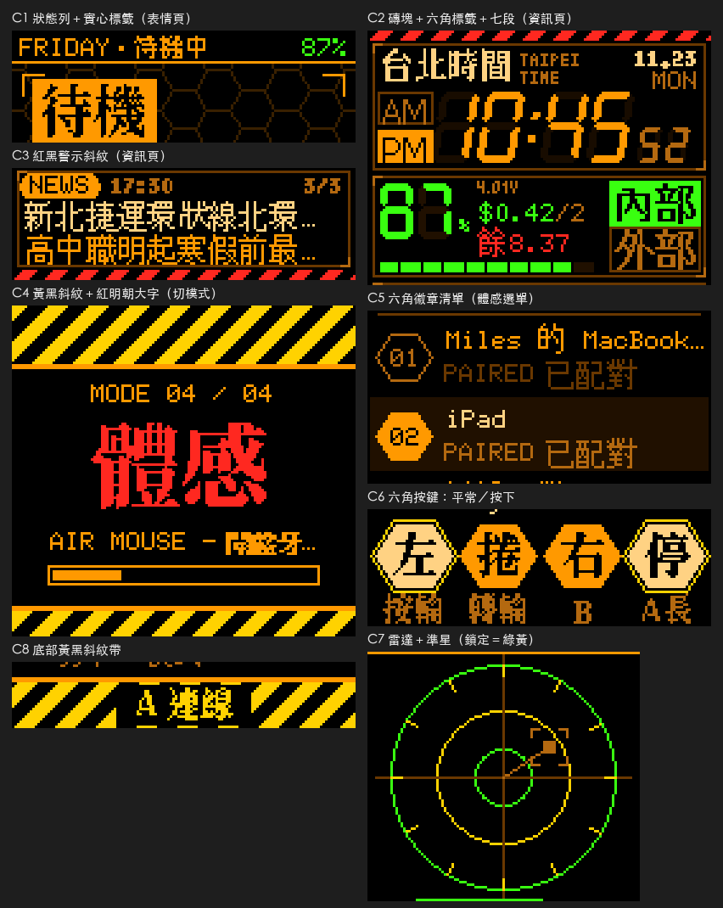

# M5S3Pack 介面設計總則（接手必讀）

> 2026-11-23 定稿。適用範圍：表情頁、資訊頁、B 切模式過場、體感（M4-2）、電源鍵長按／關機／ROOT。
> **之後所有新畫面（M1.5 紅外線、M2 HID、M3 射頻…）都照這份做。** 跟這份衝突時先問 Miles，不要自己發明新風格。
> 元件目錄與程式位置：[COMPONENTS.md](COMPONENTS.md)。實際畫面截圖：[img/](img/)。介面規格 HTML 第「D」節是這份的摘要。

## 0. 一句話

**NERV 橘黑終端機**：黑底、琥珀色為主、靠亮度分層，狀態色只用綠／黃／紅；大字用紅色或琥珀的粗明朝點陣字；警示用斜紋；形狀用「左右尖」的六角形；數字用七段。不要卡片式 UI、不要圓角、不要漸層、不要 emoji、不要框框堆疊。

> 反例（11-23 被退件）：用一格一格細框磚塊把每段文字框起來、10px 中文標籤、自創的鍵帽樣式——Miles：「很醜，完全跟之前的設計不一樣」。新畫面要從下面的元件組合，**不是重新設計**。

## 1. 色票（RGB）

| 名稱 | 色碼 | 用途 |
| :-- | :-- | :-- |
| 底色 | `#000000` | 所有畫面 |
| 琥珀（主色） | `#FF9B00` | 主文字、標籤底、外框強調、六角鍵底 |
| 亮橘白 | `#FFD080` | 強調、選中項目文字、按下時的六角底 |
| 暗橘 | `#B06A10` | 次要文字、說明、未選中 |
| 框線 | `#6A3A00` | 細框、雷達格線、分隔線 |
| 未亮 | `#241300` | 七段沒亮的段、選中列底色 |
| 紅 | `#FF2923` | 錯誤、急停、破壞性倒數、警示斜紋、**切模式大字與體感大字** |
| 黃 | `#FFD000` | 注意、廣播中、黃黑斜紋、按下時的外框 |
| 綠 | `#39FF14` | 正常、已連線、電量 ≥60%、Friday 回答文字 |
| 紫 | `#B04DFF` | 只用在資訊頁 MEM 長條 |
| 米白 | `#F2E8D8` | 切模式過場的英文副標 |
| 離線灰 | `(95,94,90)` | 斷線時表情變灰 |

- 狀態色語意固定：**綠＝好／已連線、黃＝注意／進行中、紅＝錯誤／停止／危險**。不要拿來裝飾。
- 電量色：≥60 綠、20–59 黃（狀態列）、<20 紅。
- 新顏色要先問 Miles。

## 2. 字型（最常出錯的地方）

韌體 app 分割區只有 3.34MB，**只能用 `efontTW_10`、`efontTW_10_b`、`efontTW_12` 三種中文字型**（鐵則九第 15 點）。其餘一律預先產生 1-bit 點陣圖。

| 用途 | 字 | 怎麼做 |
| :-- | :-- | :-- |
| 模式大字（語音／外部操作／射頻／體感／緊急停止） | Noto Serif CJK TC **Black**，約 36px，**紅色** | `kanji_bitmaps.h`（`tools/gen_kanji.py --set mode`） |
| 狀態大字（待機、聆聽…）、台北時間、受信、電源／停止／ROOT | Noto Serif CJK TC Bold | `ui_labels.h`（`--set ui`） |
| 體感：標題、狀態字、六角鍵字、底部帶 | Noto Serif CJK TC Black，固定字級 18／15／14／13／12px、同級基線對齊 | `air_labels.h`（`tools/gen_air_labels.py`，用文字本身查表） |
| **閱讀用的字**：對話、裝置名稱、提示句、說明、錯誤訊息 | `efontTW_12` **一般字** | 直接畫。**不要疊兩次加粗、不要用明朝點陣**（Miles 11-23：表情頁對話字已是閱讀極限，加粗反而糊） |
| 小字混排（資訊頁） | 英文 `Font0`、數字 `efontTW_10_b`、中文 `efontTW_10` 逐段換 | `ui_info.cpp` 的 `txt()`／`mixedWidth()` |
| 英文標籤（MODE 04、AIR MOUSE、PAIRED、SEC、BLE） | `Font0`，全大寫 | — |
| 極小數字（電壓） | `TomThumb` | — |
| 大數字（時間、秒數、電量） | 自畫七段（兩端削尖、段間 1px 縫、沒亮的段畫「未亮」色） | `seg7()` |

- **點陣字一律原生尺寸畫**（`drawBitmap`），不要縮放；要別的大小就重新產生。
- 字型檔（Noto Serif CJK TC，SIL OFL 1.1）不放進 repo：從 `github.com/notofonts/noto-cjk` 下載 `Serif/SubsetOTF/TC/NotoSerifTC-Black.otf`／`-Bold.otf` 到本機再跑產生器。
- `efontTW_10` 黑字疊在實心底上會糊 → 實心標籤裡的中文至少用 `efontTW_12` 或點陣圖。
- **不要用「・」**（efont 沒有這個字，會變方框）；分隔點用 2×2 實心方塊畫（狀態列做法）。
- 長名稱放不下就截斷加「…」（`efontTW_12` 有這個字），不要讓字超出螢幕。

## 3. 版面

- 主要是直式 **135×240**；表情頁、資訊頁、切模式過場另有橫式 240×135（A 鍵在右／左鏡像，畫布轉向）。體感目前只有直式。
- **狀態列**（表情頁、體感）：y 0～12，左「名稱・狀態」（Font0 英文＋2×2 點＋efontTW_10 中文），右電量 %（綠黃紅），y=12 一條琥珀細線。
- 邊距 2～4px；不要把每段文字都框起來。分區用一條「框線色」細線或留白。
- 底部動作帶（體感）：最下 18px 黃黑斜紋，中間黑底放主要動作字；上面 2px 琥珀線。破壞性頁面改紅黑。
- 資訊頁用磚塊（細框＋四角亮 4px＋六角標籤），磚塊只給資訊頁那種「儀表板」用。
- 清單最多 4 列（體感選單 31px 一列）；左邊六角徽章（編號 01/02/03、＋、～），選中＝實心＋底色「未亮」。
- 135px 寬實測：`efontTW_12` 一行約 10 個中文；點陣 13px 約 9 個。先在模擬器確認不超出。

## 4. 形狀與符號

- **六角形一律左右尖**（跟表情頁背景格同方向）。實心＝啟用／事件／選中；黑底外框＝狀態／未選中；暗框＝不可用。
- 按下回饋：六角底改「亮橘白」＋外圈黃框（體感 11-23）。
- 取景角（四角 L 形）只在表情頁的臉區。
- 雷達（體感）：三圈＋十字＋12 刻度。等待＝琥珀弧線倒數＋掃描線；已連線＝圈圈綠黃交錯（鎖定）＋準星跟游標位移；破壞性倒數＝紅弧。
- 圖示用 2～3 倍放大的點陣小圖或向量線條，不用 emoji、不用字型裡的符號。

## 5. 斜紋

| 種類 | 規格 | 用在 |
| :-- | :-- | :-- |
| 紅黑警示 | 紅段 6px、週期 12px、高 4px（橫式 3px） | 資訊頁上下緣、受信對話框 |
| 黃黑斜紋 | 黃段 8px、週期 16px、`(y + row) % 16` 斜向 | 切模式過場上下大塊、體感底部帶 |
| 紅黑／黃黑交替閃 | 每 0.4 秒交替並捲動 | 電源鍵長按四邊 |
| 紅黑（底部帶） | 同黃黑規格換紅 | 體感 B 長按「放開 取消」 |

## 6. 動態與效能（硬規則）

- 畫面一律畫在 PSRAM 畫布，經 **`ui_fx::present()`** 送上螢幕（只送有變的矩形）。直接 `pushSprite` 的頁面結束後要 `ui_fx::invalidate()`。
- 換整頁（切頁、轉向）用 `ui_fx::start()` 交叉淡化 120ms，**不要用背光遮**。
- **只在有變化時重畫**。靜態頁不要每圈重畫；體感已連線頁最多約 15 張／秒，而且只在準星有動或按鍵狀態改變時才畫。
- 每幀上限 25ms（序列埠 `j` 量）；背景（六角格）用快取。
- 表情動畫用彈簧，不用線性靠近。
- 液體、碎片等連續效果：顏色和位置只在「走步」時改，不跟著即時感測值每幀變。

## 7. 互動慣例（畫面上怎麼寫）

- A＝做事／停、B＝系統鍵（短按切下一模式、按住 3 秒急停）。
- 按鍵說明格式：「鍵＋動作」，例如「A 短按 下一項」「B 按住 3 秒 回選單」；主要動作放底部帶。
- 有沒有 Scroll（或其他 Grove 配件）要顯示不同說明；沒有的功能用暗框六角標「無」，不要整個藏起來。
- 破壞性操作（關機、中斷連線、急停）：按住 0.8 秒後才出畫面，紅色進度＋七段倒數（一位小數）＋「放開 取消」；放開不觸發原本的短按動作。
- 成功連線一律綠底黑字「已連線」。

## 8. 各頁定案摘要

| 畫面 | 定案 | 程式 | 截圖 |
| :-- | :-- | :-- | :-- |
| 表情頁 | A7 像素臉（11-20／21）、A8 甩碎、A4b 充電液體 | `ui_expression.*` | [a7_face](img/a7_face.png)、[a8_a4b](img/a8_a4b_portrait.png) |
| 資訊頁 | A7 NERV 橘黑磚塊（11-20）＋11-22 MEM 紫、11-23 CHIP／耗電 | `ui_info.*` | [a7_land_info](img/a7_land_info.png) |
| B 切模式過場 | 黃黑斜紋＋紅明朝大字＋MODE 0N / 04＋進度條（11-20） | `ui_modeswitch.*` | [modeswitch](img/modeswitch.png) |
| 體感（M4-2） | 選單／等待／已連線／B 倒數（11-23） | `ui_airmenu.*`、`air_labels.h` | [menu](img/m42_menu.png)、[wait](img/m42_wait.png)、[link](img/m42_link.png) |
| 電源鍵長按／ROOT／關機 | P2（11-22）：四邊交替斜紋、六角框進度、電源→停止→ROOT | `power_key.cpp` | [p2_powerkey](img/p2_powerkey.png) |
| 急停 KILLED | 紅底（`ui_status`），之後改版時照本總則 | `ui_status.*` | — |

細節與數字見 `CLAUDE.md` 鐵則九（第 3、5、9～17 點）、鐵則十一第 2 點、鐵則十二第 19 點，以及介面規格 HTML。

## 9. 新畫面的設計流程（每個接手的模型都要照做）

1. **先讀**：本檔、[COMPONENTS.md](COMPONENTS.md)、介面規格 HTML 第 0、D、5a 節，看 `img/` 的實際截圖。
2. **列出要用哪些現成元件**，再排版。需要新元件時先說明為什麼現有的不夠。
3. **先在模擬器出圖**（`tools/sim/`，用真的 M5GFX 字型與繪圖核心，不是網頁示意圖），輸出 2 倍＋3 倍放大的 PNG 給 Miles 看；涵蓋所有狀態（空清單、滿清單、長名稱、有／無配件、錯誤、倒數）。
4. Miles 說「可以」之前**不動 `firmware/`**。他回「醜／跟之前不一樣」就回到第 1 步對照截圖，不要微調細節。
5. 固定文字產生點陣圖；閱讀用的字用 `efontTW_12` 一般字。
6. 檢查：字有沒有超出 135px、最多幾列、會不會跟底部帶或狀態列重疊、效能（只在變化時畫）。
7. 編譯、燒錄、請 Miles 看實機（**解析度與清晰度只能在實機判斷**，PNG 會被縮放）。
8. 定稿後：截圖放 `docs/design/img/`＋嵌進介面規格 HTML、新規則寫進 `CLAUDE.md`、新元件補進 [COMPONENTS.md](COMPONENTS.md)、`PROGRESS.md` 記一筆。

## 10. 待辦（設計系統本身）

- 共用元件目前在各頁各有一份（`seg7`、六角、斜紋、狀態列）。之後抽成 `firmware/src/ui_kit.*` 共用（要整頁回歸比對模擬圖，另開切片做，不要順手改）。
- 狀態列的中文目前是 `efontTW_10`（表情頁、體感一致）。要改粗明朝需三頁一起改、狀態列加高，Miles 尚未決定。
